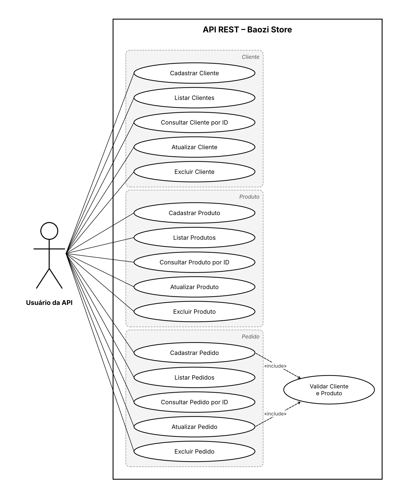

# Baozi Store – API REST

Trabalho da disciplina **Desenvolvimento Web Back-End**.
Aluno: Diego Castro, RU 5232529.

API REST simples para a Baozi Store, uma loja que vende pão chinês. Ela controla clientes, produtos e pedidos.

## Tecnologias

- Java 17+
- Spring Boot 3.3 (Spring Web / MVC)
- Spring Data JPA
- H2 Database (padrão) ou MySQL (perfil opcional)
- Postman para os testes

## Estrutura do projeto

```
src/main/java/com/baozistore
├── BaoziStoreApplication.java   -> classe principal
├── model/                       -> entidades JPA (Cliente, Produto, Pedido)
├── repository/                  -> interfaces JpaRepository
└── controller/                  -> endpoints REST (@RestController)
```

## Entidades

| Entidade | Campos |
|---|---|
| Cliente | id (Long), nome (String), clienteDesde (LocalDate) |
| Produto | id (Long), nome (String), preco (BigDecimal), estoque (Boolean) |
| Pedido  | id (Long), clienteId (Long), produtoId (Long), quantidade (Integer) |

## Endpoints

Base URL: `http://localhost:8080`

| Método | Cliente | Produto | Pedido | Descrição |
|---|---|---|---|---|
| POST   | `/clientes`      | `/produtos`      | `/pedidos`      | Criar |
| GET    | `/clientes`      | `/produtos`      | `/pedidos`      | Listar todos |
| GET    | `/clientes/{id}` | `/produtos/{id}` | `/pedidos/{id}` | Consultar por ID |
| PUT    | `/clientes/{id}` | `/produtos/{id}` | `/pedidos/{id}` | Atualizar (opcional) |
| DELETE | `/clientes/{id}` | `/produtos/{id}` | `/pedidos/{id}` | Apagar |

Códigos de resposta: `201` criado, `200` ok, `204` apagado, `404` não encontrado e `400` pedido inválido (cliente ou produto inexistente, ou quantidade menor ou igual a zero).

### Exemplos de JSON

```json
POST /clientes
{ "nome": "Diego5232529", "clienteDesde": "2026-10-10" }

POST /produtos
{ "nome": "Baozi de Porco", "preco": 8.50, "estoque": true }

POST /pedidos
{ "clienteId": 1, "produtoId": 1, "quantidade": 6 }
```

## Como rodar

**IntelliJ IDEA (recomendado):** abra a pasta do projeto (ele reconhece o `pom.xml`). Espere o Maven baixar as dependências e rode a classe `BaoziStoreApplication`.

**Linha de comando (com Maven instalado):**

```bash
mvn spring-boot:run
```

A API sobe em `http://localhost:8080`.

O banco padrão é o **H2 em memória**: os dados são apagados sempre que a aplicação reinicia. O console do banco fica em `http://localhost:8080/h2-console`, com JDBC URL `jdbc:h2:mem:baozistore`, usuário `sa` e senha em branco.

### Usando MySQL (opcional)

Ajuste o usuário e a senha em `src/main/resources/application-mysql.properties` e rode com o perfil `mysql` ativo:

```bash
mvn spring-boot:run -Dspring-boot.run.profiles=mysql
```

## Testes no Postman

Importe o arquivo `postman/Baozi-Store.postman_collection.json` no Postman (**Import**) e execute as requisições na ordem das pastas (1 a 5).

## Diagrama de caso de uso


